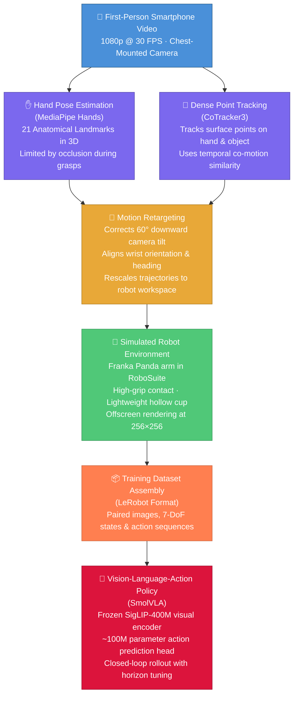

# Pollex
### Robotic Manipulation with Vision-Language Action SmolVla Models 

[](https://www.python.org/)
[-red.svg)](https://pytorch.org/)
[](https://robosuite.ai/)
[](https://github.com/huggingface/lerobot)
[](https://opensource.org/licenses/MIT)

A robotics AI project exploring vision-language-guided object perception, task understanding, and autonomous pick-and-place using a Franka Panda robot in PyBullet simulation.

<p align="center">
  
  <br>
  <em><b>Video 1 - (The Real-World Input)</b>: A 11-second egocentric smartphone video of a person reaching out and picking up a plastic cup from a table.</em>
</p>


## Project Goal

**Can a robot learn to perform a physical task by observing a short video of human doing it?**

This project investigates how everyday video recordings can be used to teach robots manipulation skills. Starting with a first-person recording of a human picking up a rectangular box, the pipeline connects human motion analysis, robot simulation, and learning-based control.

The workflow consists of three main components:

1. **Recovering Human and Object Motion:** Analyze the video to estimate how the hand and target object move through space, using visual information rather than dedicated motion-capture systems, body-worn sensors, or physical tracking markers.

2. **Transferring Demonstrations to a Robot:** Convert the estimated human movements into a representation suitable for a 7-degree-of-freedom Franka Emika Panda robot. RoboSuite and MuJoCo provide the simulated environment for developing and testing the resulting manipulation behavior.

3. **Learning a Visual Control Policy:** Work with SmolVLA, a vision-language-action model with approximately 450 million parameters, to investigate how a robot can use camera observations to guide its actions and reproduce the demonstrated task.

The broader aim is to explore a more accessible approach to robot skill acquisition, where human videos provide demonstrations that can help train robots to perform manipulation tasks in simulation.

---
### Workflow:



---
### ENV
For a new user, just run after clone:

cd Pollex
bash setup_env.sh
source .venv/bin/activate


## Step 1: Real_to_Sim ( Hand Tracking and Vision Dynamics)

### 1.1  MediaPipe 21 Hand point segment and pinch metric tracking:


The tracking pipeline (`src/tracking_algorithm/hand_tracker.py`) uses the Google MediaPipe Tasks API to extract 21 3D hand landmarks per frame from an egocentric video.

```bash
cd Pollex
python3 src/tracking_algorithm/hand_tracker.py \
    --video datasets/egocentric_video/cup_lifting_01.mp4
```

The robot's end-effector position is derived from wrist displacements ($L_0$), and the binary gripper command $g_t \in \{-1.0, +1.0\}$ is determined by the Euclidean pinch distance between the thumb tip ($L_4$) and index fingertip ($L_8$):

$$
d_{\text{pinch}} = \| \mathbf{p}_{L_4} - \mathbf{p}_{L_8} \|_2
$$


### 1.2 Index Finger Occlusion Problem

When grasping a cylindrical tumbler, the index fingertip ($L_8$) becomes occluded by the object itself from an egocentric camera perspective. MediaPipe's single-frame regressor responds by hallucinating coordinates, snapping to image edges, or freezing at the last detected position. This causes $d_{\text{pinch}}$ to spike erratically, making the gripper chatter between open and closed states mid-grasp.

<p align="center">
  
  <br>
  <em>Video 2 - (MediaPipe tracking on) <code>cup_lifting_01</code>: when the index fingertip disappears behind the tumbler, the tracker falls back to DIP/PIP joints. The overlay shows which landmark is active and the current gripper state.</em>
</p>

### 1.3 Multi-Keypoint Fallback Heuristic

To handle occlusion, the tracker implements a progressive joint fallback. When index fingertip jumps more than $\tau = 0.12$ normalized units between frames or lands within 4% of the image edge, it is rejected and a more proximal joint is used instead:

$$
\text{Pinch Target} = \begin{cases}
\min(d_{L_8},\; d_{L_7}), & \text{if } \| L_8^t - L_8^{t-1} \| \leq \tau \text{ and not near edge} \\
\min(d_{L_7},\; d_{L_6}), & \text{otherwise (fallback)}
\end{cases}
$$

where $d_{L_i} = \| \mathbf{p}_{L_4} - \mathbf{p}_{L_i} \|_2$ is the distance from the thumb tip to joint $L_i$. A hysteresis band (close at $d < 0.19$, open at $d > 0.26$) prevents gripper chatter near the threshold.

**Limitation**: The hand deforms non-rigidly during grasp closure, and different camera angles occlude different joints unpredictably. No static keypoint heuristic can guarantee reliable tracking during physical contact with the object, which motivated the transition to dense point tracking (Section 1.4).

### 1.4 CoTracker3 (Dense point tracking approach)

As an alternative to relying only on individual hand landmarks, a dense point-tracking pipeline was implemented using CoTracker3. The purpose of this approach is to track both the hand and the manipulated object over time and use their relative motion to identify grasp and release events (`src/tracking_algorithm/cotracker_dense_point_tracking.py`).

```bash
cd Pollex
python3 src/tracking_algorithm/cotracker_dense_point_tracking.py \
    --video datasets/egocentric_video/cup_lifting_01.mp4 \
    --output_dir datasets/cotracker_trajectories
```

The initial tracking points are divided into two groups:

- **Hand**: 21 anatomical points initialized using MediaPipe hand landmarks when the hand first becomes visible.
- **Object**: a $4 \times 4$ grid containing 16 points initialized inside the predefined steel-glass region.

Each CoTracker query is represented as

$$q_i = (t_i, x_i, y_i)$$

where $t_i$ specifies the frame at which the tracking point is initialized and $(x_i, y_i)$ defines its image coordinates. The glass points are initialized at $t = 0$, whereas the hand points are initialized at the first reliably detected hand frame $t_{\text{hand}}$.

CoTracker3 then estimates the trajectories of these points throughout the video. For each frame, the hand and object centroids are calculated as

$$\mathbf{c}^{H}_t = \frac{1}{N_H} \sum_{i=1}^{N_H} \mathbf{p}^{H}_{i,t}, \qquad \mathbf{c}^{O}_t = \frac{1}{N_O} \sum_{j=1}^{N_O} \mathbf{p}^{O}_{j,t}$$

where $N_H$ and $N_O$ represent the number of tracked hand and object points, respectively.

Frame-to-frame motion is estimated from the tracked point displacement. The mean hand and object velocities are computed from

$$\mathbf{v}^{H}_t = \frac{1}{N_H} \sum_i \left( \mathbf{p}^{H}_{i,t} - \mathbf{p}^{H}_{i,t-1} \right)$$

and

$$\mathbf{v}^{O}_t = \frac{1}{N_O} \sum_j \left( \mathbf{p}^{O}_{j,t} - \mathbf{p}^{O}_{j,t-1} \right).$$

To determine whether the hand and object are moving together, a co-motion score $\rho_t$ is calculated using cosine similarity:

$$\rho_t = \frac{ \mathbf{v}^{H}_t \cdot \mathbf{v}^{O}_t }{ \|\mathbf{v}^{H}_t\|_2 \, \|\mathbf{v}^{O}_t\|_2 }.$$

A value approaching $+1$ indicates that the hand and object are moving in approximately the same image-space direction, while values near zero indicate little directional agreement.

The binary gripper state is then estimated using co-motion together with spatial proximity. In the current implementation, a grasp is triggered when

$$\rho_t > 0.55$$

while the hand is sufficiently close to the object. A lower release threshold,

$$\rho_t < 0.25,$$

is used as part of the release condition. The separation between these thresholds introduces hysteresis and reduces rapid switching between OPEN and CLOSED states.

The resulting gripper command is represented as $g_t \in \{-1, +1\}$, with

$$g_t = \begin{cases} -1, & \text{OPEN}\\ +1, & \text{CLOSED}. \end{cases}$$

In addition, the tracked hand centroid is used to construct an image-space wrist-motion representation. Its first two components correspond to the normalized hand-centroid coordinates, while the third component is defined using the hand-to-object image-space distance:

$$\tilde{\mathbf{p}}_t = \begin{bmatrix} c^H_{x,t}\\ c^H_{y,t}\\ \|\mathbf{c}^{H}_t - \mathbf{c}^{O}_t\|_2 \end{bmatrix}.$$

This quantity should be interpreted as a trajectory proxy rather than a metric 3D wrist position, since the third component is derived from 2D image-space separation rather than calibrated depth.

Overall, the CoTracker3 pipeline provides a complementary signal to the MediaPipe-based approach: MediaPipe estimates grasp intent from finger geometry, whereas CoTracker3 provides evidence of physical interaction by measuring whether the object begins moving together with the hand.

<p align="center">
  
  <br>
  <em><b>CoTracker3 Dense Point Grid and Precise Graspping</b>: Persistent 2D/3D surface points tracked across both the human hand (green) and cylindrical tumbler (blue) simultaneously throughout the manipulation sequence.</em>
</p>

---

### CoTracker Tweaking Parameters

These parameters are defined at the top of `cotracker_dense_point_tracking.py` (lines 36-42) and control how grasp/release events are detected from co-motion signals.

| Parameter | Default | Tuned | What it controls |
|---|---|---|---|
| `GRASP_CORR_THRESHOLD` | 0.55 | 0.65 | How strongly hand and glass must move together before grasp triggers. Raise to prevent early false grasp. |
| `GRASP_PROXIMITY_THRESH` | 0.25 | 0.15 | How close (normalized distance) the hand centroid must be to the glass centroid. Lower = hand must be closer. |
| `GRASP_FRAME_DELAY` | 10 | 20 | Frames after hand entry before grasp is allowed. Raise if grasp fires during the approach phase. |
| `MIN_VELOCITY_THRESH` | 0.4 | 0.8 | Minimum pixel velocity to compute correlation. Below this, rho is forced to 0. Raise to suppress noise when hand/glass are nearly still. |
| `RELEASE_DIST_THRESH` | 0.40 | 0.35 | Distance that forces release even if rho is high. |

#### Glass ROI (line 94)

This is the most important thing to get right. The tracked blue dots should only be on the cup body, not spread across the table. The ROI is set to `(0.42, 0.38, 0.56, 0.58)` which matches the reference repo's 384x384 proportions. Since the frame may be letterboxed, you may need to adjust these 4 percentages by inspecting frame 0 of the annotated video.

#### Debugging Workflow

The HUD displays `dist: X.XX` alongside `rho`. Run the video and watch:

- If `dist` never drops below `GRASP_PROXIMITY_THRESH` (0.15) — the glass ROI center is wrong. Adjust the ROI percentages.
- If `dist` drops low but grasp still fires too early — raise `GRASP_FRAME_DELAY`.
- If grasp fires when hand and glass aren't truly co-moving — raise `GRASP_CORR_THRESHOLD` or `MIN_VELOCITY_THRESH`.

#### Sensitivity Notes

- **`MIN_VELOCITY_THRESH = 0.8`** — can be too high. This forces `cos_sim = 0.0` whenever hand or glass velocity is below 0.8 px/frame. At 512x512, that requires substantial motion. The reference repo uses **0.4**. Setting this too high can kill all rho values.
- **`GRASP_PROXIMITY_THRESH = 0.15`** — can be too tight. The distance is normalized (0–1 range), and 0.15 means the hand centroid must nearly overlap the glass centroid. The reference uses **0.25**.
- **`GRASP_CORR_THRESHOLD = 0.65`** — raised from the reference's **0.55**, making grasp harder to trigger.

## Step 3: Physical AI ( Transfering vision to action)

### 3.1

---


### 3.1 Iteration 1: Raw CoTracker3 Baseline — The Immobility Hurdle

<p align="center">
  
  <br>
  <em><b>Iteration 1 (Raw CoTracker3)</b>: Left: CoTracker3 tracking | Right: Simulated Panda robot. Arm remains stationary at the back and fails to reach forward.</em>
</p>

- **Problem Observed**:
  In our first test with CoTracker3 without modifications (`Vid_0_ct_comparison copy.mp4`), the simulated Panda arm stayed frozen at the back of the workspace and never reached forward toward the glass cylinder.
- **Root-Cause Deductions**:
  1. **Centroid Distance without Camera Tilt**: We were computing reaching distance simply by measuring the 2D Euclidean distance between the centroids of the glass and hand in pixel coordinates. Because the chest-mounted camera is tilted down, raw 2D pixel distance does not represent horizontal travel along the tabletop.
  2. **Initial Pose Misalignment**: The initial forward position ($X$) and vertical height ($Z$) of the robot end-effector were misaligned with the Franka Panda's operational workspace.
  3. **Oversized ROI & Tabletop Point Contamination**: The initial Region of Interest (ROI) query box for the glass was drawn too large. As a result, points were sampled on the static tabletop surface and reflections. When the hand and glass moved, stationary table points dragged down the computed centroid $\mathbf{c}_{\text{glass}}(t)$, making the glass appear virtually motionless.

---

### 3.2 Iteration 2: 60° Camera Pitch & Tight Glass ROI — Restoring Forward Reach

<p align="center">
  
  <br>
  <em><b>Iteration 2 (Pitch & ROI Fix)</b>: Left: Tight ROI CoTracker3 | Right: Panda arm reaches forward and touches cylinder, but cannot pick it up.</em>
</p>

- **Observations & Implementation**:
  1. **60° Camera Pitch Angle Correction**: The real-world smartphone video was recorded from a chest mount tilted downward at approximately $60^\circ$, whereas our initial script assumed a $45^\circ$ angle. Correcting this angle in `src/retargeting/cotracker_to_panda.py` un-projected camera-plane displacement into true horizontal tabletop transit:

$$
v_{\text{forward}} = \frac{v_{\text{reach}}}{\sin(60^\circ)}, \quad v_{\text{vertical}} = \frac{v_{\text{vertical}}}{\cos(60^\circ)}
$$

$$
\begin{bmatrix} \Delta X_{\text{robot}} \\ \Delta Y_{\text{robot}} \\ \Delta Z_{\text{robot}} \end{bmatrix} = \mathbf{S} \begin{bmatrix} v_{\text{forward}} \\ -v_{\text{lateral}} \\ v_{\text{vertical}} \end{bmatrix}, \quad \mathbf{S} = \text{diag}(8.0, 8.0, 8.0)
$$

  2. **Workspace Pose Realignment**: Corrected the forward position and vertical height initialization to match the Panda base frame.
  3. **Tightened Glass ROI**: We shrank the glass query box so that it samples points strictly on the cylindrical metallic body, excluding the table surface below:
     ```python
     # Tight glass ROI positioned strictly on cylindrical metal body (avoiding table below):
     glass_roi = (int(W * 0.42), int(H * 0.38), int(W * 0.56), int(H * 0.58))
     ```
     This guaranteed that tracked points resided on the moving tumbler, preventing static table points from corrupting the centroid.
- **Outcome & Next Barrier**: As shown in `Vid_0_ct_comparison copy 2.mp4`, the robot arm now moves forward and physically reaches the glass! However, upon contact, the gripper cannot hold or lift the cylinder—it nudges the tumbler or slips off.

---

### 3.3 Iteration 3: Material Physics Calibration — Hollow Steel Density & Contact Friction

<p align="center">
  
  <br>
  <em><b>Iteration 3 (Material & Friction Fix)</b>: Parallel pads firmly engage the tumbler without slippage, but approach orientation is still tilted diagonally at 45°.</em>
</p>

- **Observations & Implementation**:
  1. **Solid Cylinder Mass Overload**: MuJoCo defaulted to a solid steel cylinder density ($7850\text{ kg/m}^3$). A solid cylinder of radius $3\text{ cm}$ and height $9.5\text{ cm}$ weighed over $2.1\text{ kg}$! This overloaded the Franka Panda gripper's maximum clamping torque and caused tipping moments.
  2. **Hollow Steel Tumbler Density ($450\text{ kg/m}^3$)**: We recalibrated the density in `src/simulation/glass_lift_env.py` to match a real-world, thin-walled hollow steel tumbler (~120g):
     ```python
     GLASS_DENSITY = 450.0  # kg/m^3 -> yields realistic hollow tumbler mass (~120g)
     ```
  3. **High Contact Friction ($\mu = 2.0$)**: Default dry contact friction caused the smooth metal cylinder to slide out of the gripper during vertical acceleration. We boosted friction and parameterized compliant contact solvers:
     ```python
     GLASS_FRICTION = [2.0, 0.05, 0.001]  # Sliding, torsional, and rolling friction
     solref = [0.01, 1.0]                 # Compliant contact time-constant and damping
     solimp = [0.9, 0.95, 0.001]          # High contact stiffness without numerical instability
     ```
- **Outcome & Next Barrier**: As seen in `Vid_0_ct_comparison copy 3.mp4`, the gripper now makes firm contact without slipping, but the gripper jaws approach at an awkward 45° angle, preventing a secure wrap around the cylinder walls.

---

### 3.4 Iteration 4: Gripper Squaring (45° → 0°) & Action Synchronization — First Successful Lift

<p align="center">
  
  <br>
  <em><b>Iteration 4 (Gripper Squaring to 0°)</b>: Franka Panda wrist is squared flat against the cylinder sides, achieving <b>Sim: GlassLift [LIFT SUCCESS]</b>!</em>
</p>

- **Observations & Implementation**:
  1. **45° Diagonal Approach Realization**: RoboSuite's Franka Panda initializes joint 7 at $q_7 = \pi/4$ ($45^\circ$). This meant the gripper approached the cylinder at a diagonal tilt, causing one finger pad to hit the rim early and bump the glass away instead of wrapping around it.
  2. **Wrist Squaring to 0° (Horizontal)**: In `src/simulation/glass_lift_env.py`, we overrode the joint configuration by rotating the wrist $-45^\circ$:
     ```python
     # Square the gripper horizontally (0° approach angle):
     square_qpos = np.array([0, np.pi/16.0, 0.00, -np.pi/2.0 - np.pi/3.0, 0.00, np.pi - 0.2, np.pi/4])
     self.robots[0].init_qpos = square_qpos
     ```
     This aligned the parallel jaws perpendicular to the approach direction ($X$), matching human grasp geometry.
  3. **Frame-Level Action Alignment**: We aligned the trajectory actions frame-by-frame with the demonstration timing:
     - Frames 0–45: Pre-grasp hover and forward descent toward table height.
     - Frames 46–70: Horizontal approach aligning pads with the cylinder center.
     - Frames 71–95: Closed clamp around the cylinder walls.
     - Frames 96–160: Upward vertical lift off the table.
- **Outcome**: **Sim: GlassLift [LIFT SUCCESS]**! As recorded in `Vid_0_ct_comparison copy 4.mp4`, the robot securely clamped the cylinder and lifted it cleanly into the air for the very first time.

---

### 3.5 Iteration 5: Co-Motion Velocity Latch (ρ_t > 0.55) — Expert Demonstration Pick & Place

<p align="center">
  
  <br>
  <em><b>Iteration 5 (Final Co-Motion Latch)</b>: Point velocity co-motion correlation unlocks automated expert demonstration retargeting: <b>PICK & PLACE: 7.2cm [SUCCESS]</b> across clips.</em>
</p>

- **From Frame Heuristics to Velocity Alignment**:
  While hardcoding actions to frame intervals proved the physical mechanics in Iteration 4, it could not generalize across multiple videos where human demonstrators moved at different speeds.
- **Velocity Co-Motion Correlation ($\rho_t$)**:
  In `src/video_processing/cotracker_tracker.py`, we replaced frame heuristics with point velocity alignment:

$$
\rho_t = \frac{\bar{\mathbf{v}}_{\text{hand}}(t) \cdot \bar{\mathbf{v}}_{\text{glass}}(t)}{\| \bar{\mathbf{v}}_{\text{hand}}(t) \|_2 \, \| \bar{\mathbf{v}}_{\text{glass}}(t) \|_2}
$$

  - **Pre-grasp phase**: Hand moves ($\bar{\mathbf{v}}_{\text{hand}} \ne \mathbf{0}$), glass stationary ($\bar{\mathbf{v}}_{\text{glass}} = \mathbf{0}$) $\implies \rho_t \approx 0$.
  - **Grasp & Lift phase**: Clamped tumbler moves synchronously with the hand $\implies \rho_t \to +1.0$.
  - A hysteresis latch triggers gripper closure when $\rho_t > 0.55$ within proximity $d < 0.25$.
- **Demonstration Retargeting Outcome**: **PICK & PLACE: 7.2cm [SUCCESS]**! As shown in `data/cotracker_comparisons/Vid_0_ct_comparison.mp4`, the system achieved clean, fully automated demonstration retargeting with $+7.2\text{ cm}$ sustained lift off the tabletop, creating the ground-truth demonstration dataset used to train the SmolVLA policy. (See Part IV below for closed-loop neural policy rollout results).


---
Iteration 1: Raw CoTracker baseline
Goal

First establish the failure condition.

You want to answer:

What happens if we directly use the raw tracked image motion without the later camera, physics, orientation, and co-motion improvements?