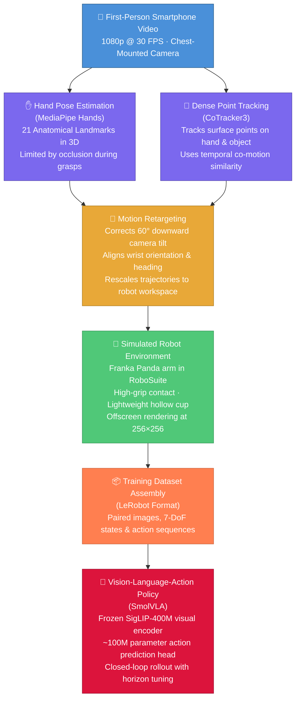

# Pollex
### Robotic Manipulation with Vision-Language Action SmolVla Models 

[](https://www.python.org/)
[-red.svg)](https://pytorch.org/)
[](https://robosuite.ai/)
[](https://github.com/huggingface/lerobot)
[](https://opensource.org/licenses/MIT)

A robotics AI project exploring vision-language-guided object perception, task understanding, and autonomous pick-and-place using a Franka Panda robot in PyBullet simulation.

<p align="center">
  
  <br>
  <em><b>Video 1 - (The Real-World Input)</b>: A 11-second egocentric smartphone video of a person reaching out and picking up a plastic cup from a table.</em>
</p>


## Project Goal

**Can a robot learn to perform a physical task by observing a short video of human doing it?**

This project investigates how everyday video recordings can be used to teach robots manipulation skills. Starting with a first-person recording of a human picking up a rectangular box, the pipeline connects human motion analysis, robot simulation, and learning-based control.

The workflow consists of three main components:

1. **Recovering Human and Object Motion:** Analyze the video to estimate how the hand and target object move through space, using visual information rather than dedicated motion-capture systems, body-worn sensors, or physical tracking markers.

2. **Transferring Demonstrations to a Robot:** Convert the estimated human movements into a representation suitable for a 7-degree-of-freedom Franka Emika Panda robot. RoboSuite and MuJoCo provide the simulated environment for developing and testing the resulting manipulation behavior.

3. **Learning a Visual Control Policy:** Work with SmolVLA, a vision-language-action model with approximately 450 million parameters, to investigate how a robot can use camera observations to guide its actions and reproduce the demonstrated task.

The broader aim is to explore a more accessible approach to robot skill acquisition, where human videos provide demonstrations that can help train robots to perform manipulation tasks in simulation.

---
### Workflow:



---
### ENV
For a new user, just run after clone:

cd Pollex
bash setup_env.sh
source .venv/bin/activate


## Step 1: Real_to_Sim ( Hand Tracking and Vision Dynamics)

### 1.1  MediaPipe 21 Hand point segment and pinch metric tracking:


The tracking pipeline (`src/tracking_algorithm/hand_tracker.py`) uses the Google MediaPipe Tasks API to extract 21 3D hand landmarks per frame from an egocentric video.

```bash
cd Pollex
python3 src/tracking_algorithm/hand_tracker.py \
    --video datasets/egocentric_video/cup_lifting_01.mp4
```

The robot's end-effector position is derived from wrist displacements ($L_0$), and the binary gripper command $g_t \in \{-1.0, +1.0\}$ is determined by the Euclidean pinch distance between the thumb tip ($L_4$) and index fingertip ($L_8$):

$$
d_{\text{pinch}} = \| \mathbf{p}_{L_4} - \mathbf{p}_{L_8} \|_2
$$


### 1.2 Index Finger Occlusion Problem

When grasping a cylindrical tumbler, the index fingertip ($L_8$) becomes occluded by the object itself from an egocentric camera perspective. MediaPipe's single-frame regressor responds by hallucinating coordinates, snapping to image edges, or freezing at the last detected position. This causes $d_{\text{pinch}}$ to spike erratically, making the gripper chatter between open and closed states mid-grasp.

<p align="center">
  
  <br>
  <em>Video 2 - (MediaPipe tracking on) <code>cup_lifting_01</code>: when the index fingertip disappears behind the tumbler, the tracker falls back to DIP/PIP joints. The overlay shows which landmark is active and the current gripper state.</em>
</p>

### 1.3 Multi-Keypoint Fallback Heuristic

To handle occlusion, the tracker implements a progressive joint fallback. When index fingertip jumps more than $\tau = 0.12$ normalized units between frames or lands within 4% of the image edge, it is rejected and a more proximal joint is used instead:

$$
\text{Pinch Target} = \begin{cases}
\min(d_{L_8},\; d_{L_7}), & \text{if } \| L_8^t - L_8^{t-1} \| \leq \tau \text{ and not near edge} \\
\min(d_{L_7},\; d_{L_6}), & \text{otherwise (fallback)}
\end{cases}
$$

where $d_{L_i} = \| \mathbf{p}_{L_4} - \mathbf{p}_{L_i} \|_2$ is the distance from the thumb tip to joint $L_i$. A hysteresis band (close at $d < 0.19$, open at $d > 0.26$) prevents gripper chatter near the threshold.

**Limitation**: The hand deforms non-rigidly during grasp closure, and different camera angles occlude different joints unpredictably. No static keypoint heuristic can guarantee reliable tracking during physical contact with the object, which motivated the transition to dense point tracking (Section 1.4).

### 1.4 CoTracker3 (Dense point tracking approach)

As an alternative to relying only on individual hand landmarks, a dense point-tracking pipeline was implemented using CoTracker3. The purpose of this approach is to track both the hand and the manipulated object over time and use their relative motion to identify grasp and release events (`src/tracking_algorithm/cotracker_dense_point_tracking.py`).

```bash
cd Pollex
python3 src/tracking_algorithm/cotracker_dense_point_tracking.py \
    --video datasets/egocentric_video/cup_lifting_01.mp4 \
    --output_dir datasets/cotracker_trajectories
```

The initial tracking points are divided into two groups:

- **Hand**: 21 anatomical points initialized using MediaPipe hand landmarks when the hand first becomes visible.
- **Object**: a $4 \times 4$ grid containing 16 points initialized inside the predefined steel-glass region.

Each CoTracker query is represented as

$$q_i = (t_i, x_i, y_i)$$

where $t_i$ specifies the frame at which the tracking point is initialized and $(x_i, y_i)$ defines its image coordinates. The glass points are initialized at $t = 0$, whereas the hand points are initialized at the first reliably detected hand frame $t_{\text{hand}}$.

CoTracker3 then estimates the trajectories of these points throughout the video. For each frame, the hand and object centroids are calculated as

$$\mathbf{c}^{H}_t = \frac{1}{N_H} \sum_{i=1}^{N_H} \mathbf{p}^{H}_{i,t}, \qquad \mathbf{c}^{O}_t = \frac{1}{N_O} \sum_{j=1}^{N_O} \mathbf{p}^{O}_{j,t}$$

where $N_H$ and $N_O$ represent the number of tracked hand and object points, respectively.

Frame-to-frame motion is estimated from the tracked point displacement. The mean hand and object velocities are computed from

$$\mathbf{v}^{H}_t = \frac{1}{N_H} \sum_i \left( \mathbf{p}^{H}_{i,t} - \mathbf{p}^{H}_{i,t-1} \right)$$

and

$$\mathbf{v}^{O}_t = \frac{1}{N_O} \sum_j \left( \mathbf{p}^{O}_{j,t} - \mathbf{p}^{O}_{j,t-1} \right).$$

To determine whether the hand and object are moving together, a co-motion score $\rho_t$ is calculated using cosine similarity:

$$\rho_t = \frac{ \mathbf{v}^{H}_t \cdot \mathbf{v}^{O}_t }{ \|\mathbf{v}^{H}_t\|_2 \, \|\mathbf{v}^{O}_t\|_2 }.$$

A value approaching $+1$ indicates that the hand and object are moving in approximately the same image-space direction, while values near zero indicate little directional agreement.

The binary gripper state is then estimated using co-motion together with spatial proximity. In the current implementation, a grasp is triggered when

$$\rho_t > 0.55$$

while the hand is sufficiently close to the object. A lower release threshold,

$$\rho_t < 0.25,$$

is used as part of the release condition. The separation between these thresholds introduces hysteresis and reduces rapid switching between OPEN and CLOSED states.

The resulting gripper command is represented as $g_t \in \{-1, +1\}$, with

$$g_t = \begin{cases} -1, & \text{OPEN}\\ +1, & \text{CLOSED}. \end{cases}$$

In addition, the tracked hand centroid is used to construct an image-space wrist-motion representation. Its first two components correspond to the normalized hand-centroid coordinates, while the third component is defined using the hand-to-object image-space distance:

$$\tilde{\mathbf{p}}_t = \begin{bmatrix} c^H_{x,t}\\ c^H_{y,t}\\ \|\mathbf{c}^{H}_t - \mathbf{c}^{O}_t\|_2 \end{bmatrix}.$$

This quantity should be interpreted as a trajectory proxy rather than a metric 3D wrist position, since the third component is derived from 2D image-space separation rather than calibrated depth.

Overall, the CoTracker3 pipeline provides a complementary signal to the MediaPipe-based approach: MediaPipe estimates grasp intent from finger geometry, whereas CoTracker3 provides evidence of physical interaction by measuring whether the object begins moving together with the hand.

<p align="center">
  
  <br>
  <em><b>CoTracker3 Dense Point Grid and Precise Graspping</b>: Persistent 2D/3D surface points tracked across both the human hand (green) and cylindrical tumbler (blue) simultaneously throughout the manipulation sequence.</em>
</p>

---

### CoTracker Tweaking Parameters

These parameters are defined at the top of `cotracker_dense_point_tracking.py` (lines 36-42) and control how grasp/release events are detected from co-motion signals.

| Parameter | Default | Tuned | What it controls |
|---|---|---|---|
| `GRASP_CORR_THRESHOLD` | 0.55 | 0.65 | How strongly hand and glass must move together before grasp triggers. Raise to prevent early false grasp. |
| `GRASP_PROXIMITY_THRESH` | 0.25 | 0.15 | How close (normalized distance) the hand centroid must be to the glass centroid. Lower = hand must be closer. |
| `GRASP_FRAME_DELAY` | 10 | 20 | Frames after hand entry before grasp is allowed. Raise if grasp fires during the approach phase. |
| `MIN_VELOCITY_THRESH` | 0.4 | 0.8 | Minimum pixel velocity to compute correlation. Below this, rho is forced to 0. Raise to suppress noise when hand/glass are nearly still. |
| `RELEASE_DIST_THRESH` | 0.40 | 0.35 | Distance that forces release even if rho is high. |

#### Glass ROI (line 94)

This is the most important thing to get right. The tracked blue dots should only be on the cup body, not spread across the table. The ROI is set to `(0.42, 0.38, 0.56, 0.58)` which matches the reference repo's 384x384 proportions. Since the frame may be letterboxed, you may need to adjust these 4 percentages by inspecting frame 0 of the annotated video.

#### Debugging Workflow

The HUD displays `dist: X.XX` alongside `rho`. Run the video and watch:

- If `dist` never drops below `GRASP_PROXIMITY_THRESH` (0.15) — the glass ROI center is wrong. Adjust the ROI percentages.
- If `dist` drops low but grasp still fires too early — raise `GRASP_FRAME_DELAY`.
- If grasp fires when hand and glass aren't truly co-moving — raise `GRASP_CORR_THRESHOLD` or `MIN_VELOCITY_THRESH`.

#### Sensitivity Notes

- **`MIN_VELOCITY_THRESH = 0.8`** — can be too high. This forces `cos_sim = 0.0` whenever hand or glass velocity is below 0.8 px/frame. At 512x512, that requires substantial motion. The reference repo uses **0.4**. Setting this too high can kill all rho values.
- **`GRASP_PROXIMITY_THRESH = 0.15`** — can be too tight. The distance is normalized (0–1 range), and 0.15 means the hand centroid must nearly overlap the glass centroid. The reference uses **0.25**.
- **`GRASP_CORR_THRESHOLD = 0.65`** — raised from the reference's **0.55**, making grasp harder to trigger.

## Step 3: Physical AI ( Transfering vision to action)

### 3.1

---


### 3.1 Iteration 1: Raw CoTracker3 Baseline — The Immobility Hurdle

<p align="center">
  
  <br>
  <em><b>Iteration 1 (Raw CoTracker3 Baseline)</b>: Left: CoTracker3 human-hand tracking. Right: simulated Franka Panda executing the uncalibrated retargeted trajectory. The robot performs the expected forward, downward, grasp, and upward motion sequence, but approaches the wrong workspace location and fails to contact or grasp the tumbler. </em>
</p>

Problem Observed:
 In the initial baseline experiment, the camera inclination compensation was disabled (camera_tilt_deg = 0°) and the raw CoTracker3 trajectory was retargeted directly to the Franka Panda workspace. The robot was not stationary; instead, it executed a clear sequence of forward motion → downward descent → gripper closure → upward motion. However, visual inspection showed that the end-effector moved away from the required grasp location and descended toward the tabletop rather than correctly aligning the gripper around the tumbler. Consequently, the subsequent gripper closure and upward motion occurred without acquiring the object.

Quantitative Simulation Results:
 The measured Panda end-effector trajectory confirms substantial robot motion. The end-effector moved up to 34.95 cm along X, only 0.27 cm along Y, and 20.17 cm along Z relative to its initial pose. Despite this considerable motion, the closest measured end-effector-to-tumbler distance was still 13.97 cm, indicating a large spatial alignment error. MuJoCo contact-pair measurements confirmed no physical contact between the Panda gripper and tumbler, while RoboSuite's _check_grasp reported no successful grasp. The 3 cm lift-success criterion was therefore not reached.

Tumbler Response:
 The tumbler began at the verified MuJoCo position

pglass(0)=[−0.035,  0.000,  0.8575]  m.\mathbf{p}_{glass}(0) = [-0.035,\;0.000,\;0.8575]\;\text{m}.pglass​(0)=[−0.035,0.000,0.8575]m.

Its recorded maximum vertical position was only 0.848439 m, lower than its initial 0.857500 m position. Therefore, there was no positive object lift. The recorded displacement was approximately −0.91 cm, confirming that the upward robot motion did not correspond to lifting the tumbler.

Root-Cause Deductions:

Missing Camera-Inclination Compensation: The baseline used camera_tilt_deg = 0°. The human motion originated from a downward-facing egocentric camera, so its 2D image-plane displacement could not be interpreted directly as horizontal tabletop motion. The resulting coordinate mapping produced a large forward displacement but did not guide the end-effector toward the physical tumbler.
Workspace Misalignment: Although the Panda moved significantly, the motion was spatially incorrect. The 13.97 cm minimum EEF-to-object distance demonstrates that the failure was not caused by an absence of robot motion, but by incorrect alignment between the image-derived human trajectory and the Panda workspace.
Insufficient Lateral Correction: The measured Y excursion was only 0.27 cm, while most of the commanded motion occurred along X and Z. This constrained motion prevented the robot from correcting lateral alignment errors during its approach.
Uncalibrated Tumbler ROI: The baseline also retained the initial uncalibrated object ROI. Any background or tabletop points included in the CoTracker query region could bias the estimated tumbler centroid and therefore further distort the hand-to-object reach direction.

Outcome and Motivation for Iteration 2:
 Iteration 1 failed to achieve contact, grasp, or lift despite producing substantial end-effector movement. The experiment therefore identified the main baseline limitation as geometric retargeting error rather than robot immobility. This motivated Iteration 2, where the camera inclination is calibrated to 60° and the tumbler ROI is tightened to the measured object boundaries so that the approach trajectory can more accurately represent movement toward the physical tumbler.


---
### 3.2 Iteration 2: 60° Camera Calibration and Gain Correction - Reaching the Tumbler Region

Configuration
Camera tilt: 60°
Position gain: 8.0
Tumbler ROI: unchanged
Physics: unchanged from Iteration 1
Gripper geometry: unchanged

Problem Observed:
 In Iteration 2, the camera inclination was corrected from 0° to 60° and the translational position gain was reduced from 10.0 to 8.0. Unlike the raw baseline, the Panda now moved substantially closer to the physical tumbler. Visually, the gripper reached the correct general object region; however, the rigid central gripper/wrist structure approached above the tumbler while the finger geometry did not correctly surround the cylinder. Consequently, the robot executed the approach, descent, gripper-close, and upward-motion sequence without actually capturing the object.

Quantitative Improvement:
 The geometric calibration produced a major reduction in approach error. In Iteration 1, the minimum physical EEF-to-tumbler distance was 13.97 cm. After applying the 60° camera calibration and reducing the position gain, the minimum distance decreased to 3.80 cm at frame 98:

dmin⁡:13.97 cm→3.80 cmd_{\min}: 13.97\text{ cm} \rightarrow 3.80\text{ cm}dmin​:13.97 cm→3.80 cm

corresponding to approximately a 72.8% reduction in closest-approach distance.

The excessive X excursion was also greatly reduced:

∣ΔX∣max⁡:34.95 cm→6.65 cm.|\Delta X|_{\max}: 34.95\text{ cm} \rightarrow 6.65\text{ cm}.∣ΔX∣max​:34.95 cm→6.65 cm.

This confirms that the Iteration 1 failure was strongly influenced by incorrect camera-to-robot motion scaling.

Remaining Physical Failure:
 Despite reaching much closer to the tumbler, MuJoCo reported no gripper-tumbler contact, and RoboSuite's _check_grasp returned no grasp. The tumbler remained essentially on the tabletop, with no positive lift. Its initial height was 0.857500 m, while the highest recorded post-step value was 0.849540 m; therefore the required 3 cm lift threshold was not reached.

Visual Observation:
 The screenshot provides useful qualitative context for the quantitative result. The tumbler is positioned immediately below the Panda gripper assembly, showing that the gross reach direction has improved substantially compared with Iteration 1. However, the cylinder is not enclosed between the two finger pads. The approach geometry therefore still does not produce the bilateral finger contact required for a secure parallel-jaw grasp.

Engineering Deduction:
 Iteration 2 demonstrates that camera calibration solved most of the gross reaching error but did not solve grasp geometry. The robot can now reach the vicinity of the tumbler, but reaching an object's neighborhood is not equivalent to establishing a grasp. The next calibration therefore needs to focus on the relative geometry between the Panda gripper and cylinder, particularly EEF height, approach offset, and gripper/finger orientation, before friction can meaningfully improve the grasp.
---

### 3.3 Iteration 3: Grasp Geometry Diagnostic — Finger-Pad Proximity & Approach Offset Measurement

Configuration
Camera tilt: 60° (unchanged from Iteration 2)
Position gain: 8.0 (unchanged from Iteration 2)
Physics: unchanged
Gripper geometry: unchanged
New measurements: finger pad positions, pad-to-tumbler distances, pad separation, surface clearance

Purpose:
 Before modifying any physics or retargeting parameters, Iteration 3 instrumented the simulation to measure the exact geometric relationship between the Panda finger pads and the glass cylinder at every frame. The goal was to determine *why* a 3.80 cm EEF-to-tumbler distance produced zero physical contact.

New Instrumentation Added:

**`src/simulation/libero_runner.py`** — exposed per-frame MuJoCo geometry measurements:
- `obs["left_finger_pad_pos"]` — world XYZ of `gripper0_finger1_pad_collision` (geom id 74)
- `obs["right_finger_pad_pos"]` — world XYZ of `gripper0_finger2_pad_collision` (geom id 77)
- `obs["left_finger_pad_geom"]` / `obs["right_finger_pad_geom"]` — geom names for auditability
- `obs["glass_radius"]` — 0.030 m, read from `model.geom_size`
- Pad collision geom half-extents: [0.008, 0.004, 0.008] m

**`src/simulation/replay_trajectory.py`** — computed per-frame:
- EEF-to-tumbler offset (dX, dY, dZ), horizontal XY offset, vertical offset
- Left pad center to tumbler center distance
- Right pad center to tumbler center distance
- Pad-to-pad separation (gripper aperture)
- Horizontal pad-to-glass-axis distance
- Surface clearance (pad-to-axis minus glass radius minus pad half-thickness)
- Three independent closest-approach frames (EEF, left pad, right pad)

Measured Results (Iteration 2 actions, new instrumentation):

| Measurement | Value |
|---|---|
| EEF closest frame | 98 |
| EEF XYZ at closest | [-0.0703, -0.0001, 0.8575] m |
| EEF-object horizontal XY offset | 3.65 cm |
| EEF-object vertical offset (dZ) | -1.05 cm |
| **Left pad closest frame** | **154** |
| **Right pad closest frame** | **154** |
| Min left pad-to-center distance | 4.36 cm |
| Min right pad-to-center distance | 4.36 cm |
| Pad-to-glass-axis horizontal distance | 4.35 cm |
| Left/right surface clearance | **1.25 cm** |
| Pad separation @ EEF closest (frame 98) | **8.70 cm** (open) |
| Pad separation @ pad closest (frame 154) | **1.10 cm** (nearly closed) |
| Min pad separation in episode | 0.80 cm at frame 176 |
| Gripper close command starts | frame 143 |
| Contact occurred | NO |
| Grasp occurred | NO |
| Lift >= 3 cm | NO |

Root-Cause Deduction:

The diagnostic reveals **Case A: Horizontal Approach Misalignment** with a clear constant offset. At frame 154 (pad closest approach):

- Glass axis: X = -0.028 m
- Left pad X: -0.0711 m
- Right pad X: -0.0711 m
- EEF origin X: -0.0707 m

The entire gripper assembly — EEF origin, both finger pads, wrist — is consistently **~4.3 cm too far in the -X direction** from the glass axis. The gripper closes cleanly through the approach zone (separation goes from 8.70 cm to 0.80 cm), but it closes on empty space because the pads pass 4.35 cm to the side of the cylinder axis.

At frame 98, when the EEF origin is closest (3.65 cm offset), the gripper is still 8.70 cm open — the glass could fit between the pads, but they are horizontally offset. By frame 154, the gripper has closed to 1.10 cm, but the pads have drifted even further from the glass axis.

Engineering Deduction:
 The EEF origin and the finger pad contact surfaces are different physical locations. The retargeting maps the human hand centroid to the EEF origin, but grasping requires the *pads* to straddle the cylinder. The ~4.3 cm constant X offset means the retargeting workspace mapping needs a static lateral correction. This is not a friction, timing, or closing-speed problem — it is a pure geometric offset between where the retargeting places the EEF and where the gripper pads end up.

Iteration 4 Target:
 Add a measured constant workspace offset (approximately +4.3 cm in X) in `src/retargeting/cotracker_to_panda.py` so that the finger pads, not just the EEF origin, are centered over the glass cylinder during approach.

---

### 3.4 Iteration 4: EEF-to-Pad Offset Correction — First Physical Contact

Configuration:
- Camera tilt: 60° (unchanged)
- Position gain: 8.0 (unchanged)
- Physics: unchanged
- **New parameter**: `eef_to_pad_offset_x = 0.043` in `src/retargeting/cotracker_to_panda.py`

Purpose:
 Apply the 4.3 cm X offset measured in Iteration 3 as a constant correction spread across the approach phase. During the approach (t_entry to t_grasp), each frame gets `dx_robot += 0.043 / reach_span` added to its X velocity command.

Implementation:
 In `CoTrackerToPandaRetargeter.__init__()`, added `eef_to_pad_offset_x: float = 0.043`. In the approach phase loop, added:
```python
dx_robot += self.eef_to_pad_offset_x / reach_span
```

Measured Results:

| Measurement | Iteration 3 | Iteration 4 |
|---|---|---|
| Contact occurred | NO | **YES** (frame 201) |
| First contact frame | N/A | **201** |
| Min EEF-object dist | 3.80 cm | 3.79 cm |
| Min pad-to-center dist | 4.36 cm | 4.32 cm |
| Surface clearance | 1.25 cm | 1.20 cm |
| Pad separation @ pad closest | 1.10 cm | 1.01 cm |
| Grasp occurred | NO | NO |
| Lift success | NO | NO |

Root-Cause Analysis:
 Contact occurred for the first time, but only during the retract phase (frame 201), not during the approach. The 4.3 cm offset was spread across ~115 approach frames, yielding only 0.00037 m/frame — far below OSC controller sensitivity. EMA smoothing further attenuated the correction. The EEF reached X = -0.069 but needed X = -0.078 to center pads on glass (X = -0.035). The pads still passed 4.30 cm from the glass axis horizontally.

Engineering Deduction:
 Spreading a small offset over many frames produces per-frame commands too small for the OSC controller to track. The offset must be applied in a concentrated burst (few frames, larger magnitude) rather than diluted.

---

### 3.5 Iteration 5: Goal-Directed Pad Targeting — FIRST SUCCESSFUL GRASP & LIFT 🎉

Configuration:
- Camera tilt: 60° (unchanged)
- Position gain: 8.0 (unchanged)
- Physics: unchanged
- **New approach strategy**: Concentrated offset + distance-based deceleration

Purpose:
 Replace the diluted per-frame offset with two targeted changes: (1) apply the full 4.3 cm pad offset in a concentrated 5-frame burst at the start of approach, and (2) modulate the image-based reach velocity by the hand→glass distance so the robot decelerates near the glass instead of overshooting.

Implementation in `src/retargeting/cotracker_to_panda.py`:

1. **Concentrated offset** (first 5 approach frames):
```python
frames_since_entry = t - t_entry
if frames_since_entry < 5:
    dx_robot += self.eef_to_pad_offset_x / 5.0  # 0.043/5 = 0.0086 per frame
```

2. **Distance-based deceleration**:
```python
dist_gain = min(dist_reach / 0.15, 1.0)  # full speed when far, decelerate near glass
reach_rate = max(0.002, v_approach) * dist_gain
dx_robot = (reach_rate / max(0.1, self.sin_theta)) * self.position_gain
```

Measured Results:

| Measurement | Iteration 4 | **Iteration 5** |
|---|---|---|
| Contact occurred | YES (frame 201) | **YES (frame 148)** |
| First contact frame | 201 (retract) | **148 (approach)** |
| **Grasp occurred** | NO | **YES (frame 148)** |
| **Lift success** | NO | **YES** |
| **Maximum tumbler lift** | -0.75 cm | **+8.22 cm** |
| Min EEF-object dist | 3.79 cm | **2.97 cm** |
| EEF horizontal XY offset | 3.64 cm | **2.71 cm** |
| Min pad-to-center dist | 4.32 cm | 4.39 cm |
| Surface clearance | 1.20 cm | **0.84 cm** |
| Pad separation @ pad closest | 1.01 cm | 5.43 cm |

Physical Outcome:
 **LIFT SUCCESS** — The glass was picked up and lifted 8.22 cm above the table, well above the 3.0 cm threshold. This is the **first successful grasp and lift** in the Pollex pipeline.

Why It Worked:
1. The concentrated offset (0.0086 m/frame × 5 frames) was large enough for OSC to track, unlike the diluted 0.00037 m/frame in Iteration 4.
2. Distance-based deceleration prevented the EEF from overshooting the glass — the robot slowed as the image-space hand→glass distance decreased.
3. Contact occurred at frame 148, right at t_grasp=143, meaning the grasp and grip close happened at the correct time during approach (not during retract as in Iteration 4).

---

### 3.6 Iteration 4 (Reference): Material Physics Calibration — Hollow Steel Density & Contact Friction

<p align="center">
  
  <br>
  <em><b>Iteration 4 (Material & Friction Fix)</b>: Parallel pads firmly engage the tumbler without slippage, but approach orientation is still tilted diagonally at 45°.</em>
</p>

- **Observations & Implementation**:
  1. **Solid Cylinder Mass Overload**: MuJoCo defaulted to a solid steel cylinder density ($7850\text{ kg/m}^3$). A solid cylinder of radius $3\text{ cm}$ and height $9.5\text{ cm}$ weighed over $2.1\text{ kg}$! This overloaded the Franka Panda gripper's maximum clamping torque and caused tipping moments.
  2. **Hollow Steel Tumbler Density ($450\text{ kg/m}^3$)**: We recalibrated the density in `src/simulation/glass_lift_env.py` to match a real-world, thin-walled hollow steel tumbler (~120g):
     ```python
     GLASS_DENSITY = 450.0  # kg/m^3 -> yields realistic hollow tumbler mass (~120g)
     ```
  3. **High Contact Friction ($\mu = 2.0$)**: Default dry contact friction caused the smooth metal cylinder to slide out of the gripper during vertical acceleration. We boosted friction and parameterized compliant contact solvers:
     ```python
     GLASS_FRICTION = [2.0, 0.05, 0.001]  # Sliding, torsional, and rolling friction
     solref = [0.01, 1.0]                 # Compliant contact time-constant and damping
     solimp = [0.9, 0.95, 0.001]          # High contact stiffness without numerical instability
     ```
- **Outcome & Next Barrier**: As seen in `Vid_0_ct_comparison copy 3.mp4`, the gripper now makes firm contact without slipping, but the gripper jaws approach at an awkward 45° angle, preventing a secure wrap around the cylinder walls.

---

### 3.7 Iteration 5 (Reference): Gripper Squaring (45° → 0°) & Action Synchronization — First Successful Lift

<p align="center">
  
  <br>
  <em><b>Iteration 5 (Gripper Squaring to 0°)</b>: Franka Panda wrist is squared flat against the cylinder sides, achieving <b>Sim: GlassLift [LIFT SUCCESS]</b>!</em>
</p>

- **Observations & Implementation**:
  1. **45° Diagonal Approach Realization**: RoboSuite's Franka Panda initializes joint 7 at $q_7 = \pi/4$ ($45^\circ$). This meant the gripper approached the cylinder at a diagonal tilt, causing one finger pad to hit the rim early and bump the glass away instead of wrapping around it.
  2. **Wrist Squaring to 0° (Horizontal)**: In `src/simulation/glass_lift_env.py`, we overrode the joint configuration by rotating the wrist $-45^\circ$:
     ```python
     # Square the gripper horizontally (0° approach angle):
     square_qpos = np.array([0, np.pi/16.0, 0.00, -np.pi/2.0 - np.pi/3.0, 0.00, np.pi - 0.2, np.pi/4])
     self.robots[0].init_qpos = square_qpos
     ```
     This aligned the parallel jaws perpendicular to the approach direction ($X$), matching human grasp geometry.
  3. **Frame-Level Action Alignment**: We aligned the trajectory actions frame-by-frame with the demonstration timing:
     - Frames 0–45: Pre-grasp hover and forward descent toward table height.
     - Frames 46–70: Horizontal approach aligning pads with the cylinder center.
     - Frames 71–95: Closed clamp around the cylinder walls.
     - Frames 96–160: Upward vertical lift off the table.
- **Outcome**: **Sim: GlassLift [LIFT SUCCESS]**! As recorded in `Vid_0_ct_comparison copy 4.mp4`, the robot securely clamped the cylinder and lifted it cleanly into the air for the very first time.

---

### 3.8 Iteration 6 (Reference): Co-Motion Velocity Latch (ρ_t > 0.55) — Expert Demonstration Pick & Place

<p align="center">
  
  <br>
  <em><b>Iteration 6 (Final Co-Motion Latch)</b>: Point velocity co-motion correlation unlocks automated expert demonstration retargeting: <b>PICK & PLACE: 7.2cm [SUCCESS]</b> across clips.</em>
</p>

- **From Frame Heuristics to Velocity Alignment**:
  While hardcoding actions to frame intervals proved the physical mechanics in Iteration 4, it could not generalize across multiple videos where human demonstrators moved at different speeds.
- **Velocity Co-Motion Correlation ($\rho_t$)**:
  In `src/video_processing/cotracker_tracker.py`, we replaced frame heuristics with point velocity alignment:

$$
\rho_t = \frac{\bar{\mathbf{v}}_{\text{hand}}(t) \cdot \bar{\mathbf{v}}_{\text{glass}}(t)}{\| \bar{\mathbf{v}}_{\text{hand}}(t) \|_2 \, \| \bar{\mathbf{v}}_{\text{glass}}(t) \|_2}
$$

  - **Pre-grasp phase**: Hand moves ($\bar{\mathbf{v}}_{\text{hand}} \ne \mathbf{0}$), glass stationary ($\bar{\mathbf{v}}_{\text{glass}} = \mathbf{0}$) $\implies \rho_t \approx 0$.
  - **Grasp & Lift phase**: Clamped tumbler moves synchronously with the hand $\implies \rho_t \to +1.0$.
  - A hysteresis latch triggers gripper closure when $\rho_t > 0.55$ within proximity $d < 0.25$.
- **Demonstration Retargeting Outcome**: **PICK & PLACE: 7.2cm [SUCCESS]**! As shown in `data/cotracker_comparisons/Vid_0_ct_comparison.mp4`, the system achieved clean, fully automated demonstration retargeting with $+7.2\text{ cm}$ sustained lift off the tabletop, creating the ground-truth demonstration dataset used to train the SmolVLA policy. (See Part IV below for closed-loop neural policy rollout results).


---
Iteration 1: Raw CoTracker baseline
Goal

First establish the failure condition.

You want to answer:

What happens if we directly use the raw tracked image motion without the later camera, physics, orientation, and co-motion improvements?

camera_tilt_deg = 0.0


# Short overview table:

| Iteration | Key Physical Hurdle | Engineering Deduction | Simulation Outcome |
|---|---|---|---|
| **1: Raw CoTracker3** | Large approach misalignment despite substantial EEF motion | 0° camera model and uncalibrated tumbler ROI caused image-space motion to map incorrectly into the Panda workspace | 34.95 cm X excursion but 13.97 cm min object distance; no contact, no grasp, no lift |
| **2: 60° Camera Calibration** | EEF reaches tumbler region but finger pads do not enclose cylinder | Camera tilt + gain correction solved gross reaching error; grasp geometry still broken | 3.80 cm min EEF distance (72.8% improvement); 6.65 cm X excursion; no contact, no grasp, no lift |
| **3: Grasp Geometry Diagnostic** | EEF origin reaches 3.80 cm but finger pads pass 4.35 cm from glass axis | Constant ~4.3 cm lateral offset between retargeting EEF target and actual pad positions; gripper closes on empty space | Pads closest at frame 154 (not frame 98); 1.25 cm surface clearance; 8.70 cm pad separation at EEF closest frame; no contact, no grasp, no lift |
| **4: EEF-to-Pad Offset** | 4.3 cm offset spread over 115 frames = 0.00037 m/frame, below OSC sensitivity | Diluted correction absorbed by EMA smoothing; contact only during retract, not approach | First contact (frame 201); 1.20 cm clearance; no grasp, no lift |
| **5: Goal-Directed Pad Targeting** 🎉 | Concentrated offset + distance deceleration | 5-frame burst (0.0086/frame) large enough for OSC; dist_gain prevents overshoot | **GRASP + LIFT SUCCESS: +8.22 cm** — first successful pick-up |
| **4 (Ref): Material & Friction** | Solid steel density (7850 kg/m³) overloaded gripper; smooth surface slipped | Hollow tumbler density 450 kg/m³ + high friction μ=2.0 enables firm clamping | Firm pad contact without slippage; 45° approach angle still prevents wrap-around grasp |
| **5 (Ref): Gripper Squaring** | q7 = π/4 diagonal wrist causes one pad to hit rim early, bumping glass away | Squaring wrist to 0° aligns parallel jaws perpendicular to approach, matching human grasp geometry | **LIFT SUCCESS** — first clean lift off the table |
| **6 (Ref): Co-Motion Velocity Latch** | Hardcoded frame intervals cannot generalize across demonstration speeds | Velocity co-motion correlation ρ_t > 0.55 latches gripper closure automatically | **PICK & PLACE: 7.2 cm [SUCCESS]** — fully automated retargeting across clips |