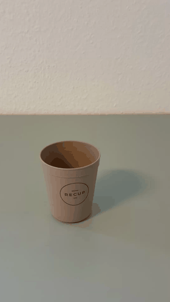
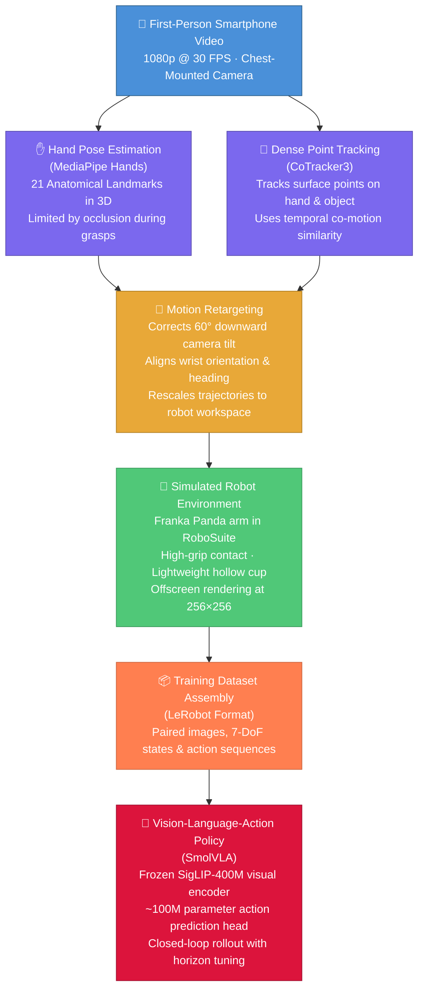
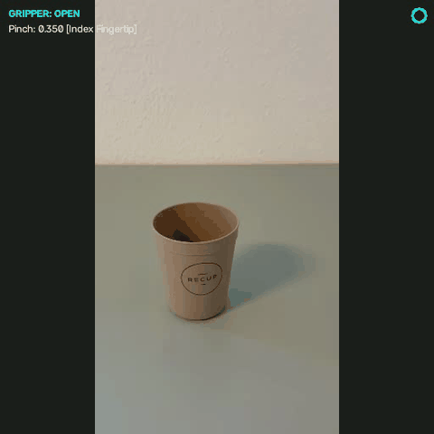

# Pollex
### Robotic Manipulation with Vision-Language Action SmolVla Models 

[](https://www.python.org/)
[-red.svg)](https://pytorch.org/)
[](https://robosuite.ai/)
[](https://github.com/huggingface/lerobot)
[](https://opensource.org/licenses/MIT)

A robotics AI project exploring vision-language-guided object perception, task understanding, and autonomous pick-and-place using a Franka Panda robot in PyBullet simulation.

<p align="center">
  
  <br>
  <em><b>The Real-World Input</b>: A 11-second egocentric smartphone video of a person reaching out and picking up a plastic cup from a table.</em>
</p>


## Project Goal

**Can a robot learn to perform a physical task by observing a short video of human doing it?**

This project investigates how everyday video recordings can be used to teach robots manipulation skills. Starting with a first-person recording of a human picking up a rectangular box, the pipeline connects human motion analysis, robot simulation, and learning-based control.

The workflow consists of three main components:

1. **Recovering Human and Object Motion:** Analyze the video to estimate how the hand and target object move through space, using visual information rather than dedicated motion-capture systems, body-worn sensors, or physical tracking markers.

2. **Transferring Demonstrations to a Robot:** Convert the estimated human movements into a representation suitable for a 7-degree-of-freedom Franka Emika Panda robot. RoboSuite and MuJoCo provide the simulated environment for developing and testing the resulting manipulation behavior.

3. **Learning a Visual Control Policy:** Work with SmolVLA, a vision-language-action model with approximately 450 million parameters, to investigate how a robot can use camera observations to guide its actions and reproduce the demonstrated task.

The broader aim is to explore a more accessible approach to robot skill acquisition, where human videos provide demonstrations that can help train robots to perform manipulation tasks in simulation.

---
### Workflow:



---
### ENV
For a new user, just run after clone:

cd Pollex
bash setup_env.sh
source .venv/bin/activate


## Step 1: Real_to_Sim ( Hand Tracking and Vision Dynamics)

### 1.1  MediaPipe 21 Hand point segment and pinch metric tracking:


The tracking pipeline (`src/tracking_algorithm/hand_tracker.py`) uses the Google MediaPipe Tasks API to extract 21 3D hand landmarks per frame from an egocentric video.

```bash
cd Pollex
python3 src/tracking_algorithm/hand_tracker.py \
    --video datasets/egocentric_video/cup_lifting_01.mp4
```

The robot's end-effector position is derived from wrist displacements ($L_0$), and the binary gripper command $g_t \in \{-1.0, +1.0\}$ is determined by the Euclidean pinch distance between the thumb tip ($L_4$) and index fingertip ($L_8$):

$$
d_{\text{pinch}} = \| \mathbf{p}_{L_4} - \mathbf{p}_{L_8} \|_2
$$


### 1.2 Index Finger Occlusion Problem

When grasping a cylindrical tumbler, the index fingertip ($L_8$) becomes occluded by the object itself from an egocentric camera perspective. MediaPipe's single-frame regressor responds by hallucinating coordinates, snapping to image edges, or freezing at the last detected position. This causes $d_{\text{pinch}}$ to spike erratically, making the gripper chatter between open and closed states mid-grasp.

<p align="center">
  
  <br>
  <em>MediaPipe tracking on <code>cup_lifting_01</code>: when the index fingertip disappears behind the tumbler, the tracker falls back to DIP/PIP joints. The overlay shows which landmark is active and the current gripper state.</em>
</p>

### 1.3 Multi-Keypoint Fallback Heuristic

To handle occlusion, the tracker implements a progressive joint fallback. When index fingertip jumps more than $\tau = 0.12$ normalized units between frames or lands within 4% of the image edge, it is rejected and a more proximal joint is used instead:

$$
\text{Pinch Target} = \begin{cases}
\min(d_{L_8},\; d_{L_7}), & \text{if } \| L_8^t - L_8^{t-1} \| \leq \tau \text{ and not near edge} \\
\min(d_{L_7},\; d_{L_6}), & \text{otherwise (fallback)}
\end{cases}
$$

where $d_{L_i} = \| \mathbf{p}_{L_4} - \mathbf{p}_{L_i} \|_2$ is the distance from the thumb tip to joint $L_i$. A hysteresis band (close at $d < 0.19$, open at $d > 0.26$) prevents gripper chatter near the threshold.

**Limitation**: The hand deforms non-rigidly during grasp closure, and different camera angles occlude different joints unpredictably. No static keypoint heuristic can guarantee reliable tracking during physical contact with the object, which motivated the transition to dense point tracking (Section 1.4).

### 1.4 CoTracker3 (Dense point tracking approach)
As an alternative to relying only on individual hand landmarks, a dense point-tracking pipeline was implemented using CoTracker3. The purpose of this approach is to track both the hand and the manipulated object over time and use their relative motion to identify grasp and release events. (`src/tracking_algorithm/cotracker_dense_point_tracking.py`). 


```bash
cd Pollex
python3 src/tracking_algorithm/cotracker_dense_point_tracking.py \
    --video datasets/egocentric_video/cup_lifting_01.mp4 \
    --output_dir datasets/cotracker_trajectories
```
The initial tracking points are divided into two groups:

Hand: 21 anatomical points initialized using MediaPipe hand landmarks when the hand first becomes visible.
Object: a 4×44\times44×4 grid containing 16 points initialized inside the predefined steel-glass region.

Each CoTracker query is represented as

qi=(ti,xi,yi)q_i=(t_i,x_i,y_i)qi​=(ti​,xi​,yi​)


where tit_iti​ specifies the frame at which the tracking point is initialized and (xi,yi)(x_i,y_i)(xi​,yi​) defines its image coordinates. The glass points are initialized at t=0t=0t=0, whereas the hand points are initialized at the first reliably detected hand frame thandt_{\text{hand}}thand​.

CoTracker3 then estimates the trajectories of these points throughout the video. For each frame, the hand and object centroids are calculated as

ctH=1NH∑i=1NHpi,tH,\mathbf{c}^{H}_t = \frac{1}{N_H} \sum_{i=1}^{N_H} \mathbf{p}^{H}_{i,t},ctH​=NH​1​i=1∑NH​​pi,tH​, ctO=1NO∑j=1NOpj,tO,\mathbf{c}^{O}_t = \frac{1}{N_O} \sum_{j=1}^{N_O} \mathbf{p}^{O}_{j,t},ctO​=NO​1​j=1∑NO​​pj,tO​,

where NHN_HNH​ and NON_ONO​ represent the number of tracked hand and object points, respectively.

Frame-to-frame motion is estimated from the tracked point displacement. The mean hand and object velocities are computed from

vtH=1NH∑i(pi,tH−pi,t−1H)\mathbf{v}^{H}_t = \frac{1}{N_H} \sum_i \left( \mathbf{p}^{H}_{i,t} - \mathbf{p}^{H}_{i,t-1} \right)vtH​=NH​1​i∑​(pi,tH​−pi,t−1H​)

and

vtO=1NO∑j(pj,tO−pj,t−1O).\mathbf{v}^{O}_t = \frac{1}{N_O} \sum_j \left( \mathbf{p}^{O}_{j,t} - \mathbf{p}^{O}_{j,t-1} \right).vtO​=NO​1​j∑​(pj,tO​−pj,t−1O​).

To determine whether the hand and object are moving together, a co-motion score ρt\rho_tρt​ is calculated using cosine similarity:

ρt=vtH⋅vtO∥vtH∥2∥vtO∥2.\rho_t = \frac{ \mathbf{v}^{H}_t \cdot \mathbf{v}^{O}_t }{ \|\mathbf{v}^{H}_t\|_2 \|\mathbf{v}^{O}_t\|_2 }.ρt​=∥vtH​∥2​∥vtO​∥2​vtH​⋅vtO​​.

A value approaching +1+1+1 indicates that the hand and object are moving in approximately the same image-space direction, while values near zero indicate little directional agreement.

The binary gripper state is then estimated using co-motion together with spatial proximity. In the current implementation, a grasp is triggered when

ρt>0.55\rho_t > 0.55ρt​>0.55

while the hand is sufficiently close to the object. A lower release threshold,

ρt<0.25,\rho_t < 0.25,ρt​<0.25,

is used as part of the release condition. The separation between these thresholds introduces hysteresis and reduces rapid switching between OPEN and CLOSED states.

The resulting gripper command is represented as

gt∈{−1,+1},g_t \in \{-1,+1\},gt​∈{−1,+1},

with

gt={−1,OPEN+1,CLOSED.g_t = \begin{cases} -1, & \text{OPEN}\\ +1, & \text{CLOSED}. \end{cases}gt​={−1,+1,​OPENCLOSED.​

In addition, the tracked hand centroid is used to construct an image-space wrist-motion representation. Its first two components correspond to the normalized hand-centroid coordinates, while the third component is defined using the hand-to-object image-space distance:

p~t=[cx,tHcy,tH∥ctH−ctO∥2].\tilde{\mathbf{p}}_t = \begin{bmatrix} c^H_{x,t}\\ c^H_{y,t}\\ \|\mathbf{c}^{H}_t-\mathbf{c}^{O}_t\|_2 \end{bmatrix}.p~​t​=​cx,tH​cy,tH​∥ctH​−ctO​∥2​​​.

This quantity should be interpreted as a trajectory proxy rather than a metric 3D wrist position, since the third component is derived from 2D image-space separation rather than calibrated depth.

Overall, the CoTracker3 pipeline provides a complementary signal to the MediaPipe-based approach: MediaPipe estimates grasp intent from finger geometry, whereas CoTracker3 provides evidence of physical interaction by measuring whether the object begins moving together with the hand.


<p align="center">
  
  <br>
  <em><b>CoTracker3 Dense Point Grid</b>: Persistent 2D/3D surface points tracked across both the human hand (green) and cylindrical tumbler (blue) simultaneously throughout the manipulation sequence.</em>
</p>

---


Cotracker parameters:

Parameters at the top of the file (lines 36-42):
Parameter	Old	New	What it controls
GRASP_CORR_THRESHOLD	0.55	0.65	How strongly hand and glass must move together before grasp triggers. Raise to prevent early false grasp.
GRASP_PROXIMITY_THRESH	0.25 (hardcoded)	0.15	How close (normalized distance) the hand centroid must be to the glass centroid. Lower = hand must be closer.
GRASP_FRAME_DELAY	10 (hardcoded)	20	Frames after hand entry before grasp is allowed. Raise if grasp fires during the approach phase.
MIN_VELOCITY_THRESH	0.4 (hardcoded)	0.8	Minimum pixel velocity to compute correlation. Below this, rho is forced to 0. Raise to suppress noise when hand/glass are nearly still.
RELEASE_DIST_THRESH	0.40 (hardcoded)	0.35	Distance that forces release even if rho is high.
Glass ROI (line 94):
This is the most important thing to get right. The blue dots in your screenshot are spread across the table — they should only be on the cup body. The ROI reverted to (0.42, 0.38, 0.56, 0.58) which matches the reference repo's 384x384 proportions. Since your frame is letterboxed now, you may need to adjust these 4 percentages by looking at frame 0 of your annotated video.

Debugging workflow
The HUD now shows dist: X.XX alongside rho. Run the video and watch:

If dist never drops below GRASP_PROXIMITY_THRESH (0.15), the glass ROI center is wrong — adjust the ROI percentages
If dist drops low but grasp still fires too early, raise GRASP_FRAME_DELAY
If grasp fires when hand and glass aren't truly co-moving, raise GRASP_CORR_THRESHOLD or MIN_VELOCITY_THRESH


GRASP:
MIN_VELOCITY_THRESH = 0.8 — too high. This forces cos_sim = 0.0 whenever hand or glass velocity is below 0.8 px/frame. At 512x512, that's quite a lot of motion. The reference repo uses 0.4. This alone could be killing all your rho values.

GRASP_PROXIMITY_THRESH = 0.15 — too tight. The distance is normalized (0-1 range), and 0.15 means the hand centroid must nearly overlap the glass centroid. The reference uses 0.25.

GRASP_CORR_THRESHOLD = 0.65 — raised from the reference's 0.55, making it harder to trigger.

